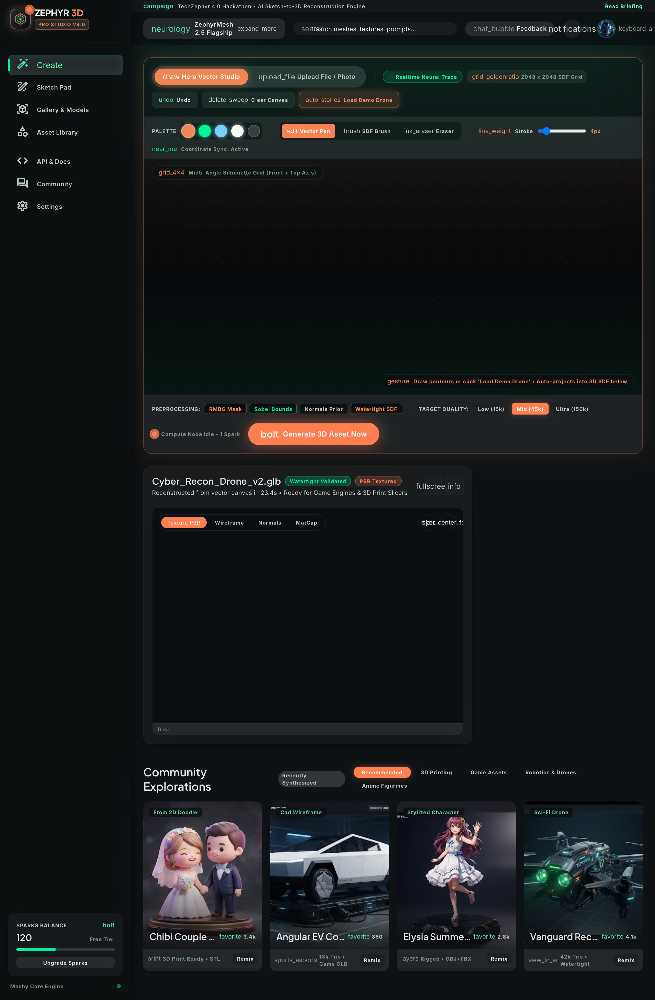
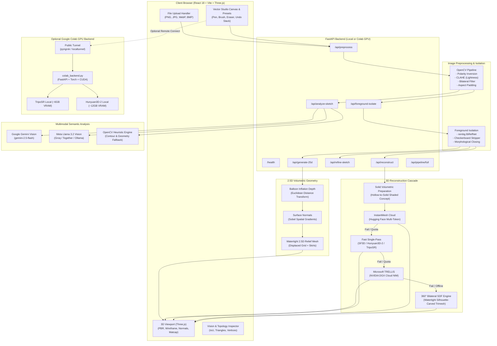

# Zephyr 3D — Autonomous 2D-to-3D Reconstruction Studio

> **Tech Zephyr 4.0 — Machine Learning Hackathon Submission**  
> *Transforming hand-drawn 2D sketches and concept art into solid, watertight 3D models and 2.5D volumetric representations through a multi-tier neural pipeline.*

[](https://www.python.org/)
[](https://fastapi.tiangolo.com/)
[](https://react.dev/)
[](https://threejs.org/)
[](https://vitejs.dev/)
[](https://tailwindcss.com/)
[](https://docs.pytest.org/)

---

## Table of Contents

1. [Overview](#1-overview)
2. [Problem Statement](#2-problem-statement)
3. [The Zephyr 3D Solution](#3-the-zephyr-3d-solution)
4. [Screenshots and Visual Demo](#4-screenshots-and-visual-demo)
5. [System Architecture](#5-system-architecture)
6. [End-to-End Workflow Pipeline](#6-end-to-end-workflow-pipeline)
7. [Machine Learning Implementation](#7-machine-learning-implementation)
   - [7.1 Pretrained Foundational Models](#71-pretrained-foundational-models)
   - [7.2 Multimodal Vision Understanding](#72-multimodal-vision-understanding)
   - [7.3 Solid Volumetric Concept Preparation](#73-solid-volumetric-concept-preparation)
   - [7.4 Multi-Tier Reconstruction Cascade](#74-multi-tier-reconstruction-cascade)
   - [7.5 AI Sketch Refinement with Quality Guardrails](#75-ai-sketch-refinement-with-quality-guardrails)
8. [3D Reconstruction & Geometry Processing](#8-3d-reconstruction--geometry-processing)
   - [8.1 2.5D Monocular Depth & Tangent-Space Normals](#81-25d-monocular-depth--tangent-space-normals)
   - [8.2 Watertight 2.5D Relief Geometry](#82-watertight-25d-relief-geometry)
   - [8.3 360° Bilateral Volumetric SDF Engine](#83-360-bilateral-volumetric-sdf-engine)
   - [8.4 Topological Hole & Aperture Preservation](#84-topological-hole--aperture-preservation)
9. [Verified Features](#9-verified-features)
10. [Technology Stack](#10-technology-stack)
11. [Repository Structure](#11-repository-structure)
12. [API Reference](#12-api-reference)
13. [Installation & Setup](#13-installation--setup)
    - [13.1 Prerequisites](#131-prerequisites)
    - [13.2 Backend Setup (Local)](#132-backend-setup-local)
    - [13.3 Frontend Setup (Local)](#133-frontend-setup-local)
    - [13.4 Google Colab GPU Backend Setup](#134-google-colab-gpu-backend-setup)
14. [Test Suite & Quality Verification](#14-test-suite--quality-verification)
15. [Limitations & Honest Evaluation](#15-limitations--honest-evaluation)

---

## 1. Overview

**Zephyr 3D** is an applied machine learning and computer graphics application developed for the Tech Zephyr ML Hackathon. The system bridges the gap between hand-drawn 2D concept art and production-ready 3D digital assets.

Users can either sketch directly in a browser-based drawing canvas or upload existing artwork (PNG, JPEG, WebP, BMP). Zephyr 3D then processes the input through a multi-stage pipeline:
1. **Normalizes and cleans** the sketch using adaptive image processing (CLAHE, bilateral denoising, polarity correction).
2. **Analyzes 3D semantics** using multimodal Large Vision-Language Models (Google Gemini Vision or Meta Llama 3.2 Vision).
3. **Isolates foreground contours** from scanner textures or paper backgrounds.
4. **Synthesizes 2.5D volumetric data** (relative monocular depth maps, tangent-space surface normals, and watertight relief geometry).
5. **Reconstructs complete 3D assets** via a cloud GPU cascade (InstantMesh, Stable Fast 3D, Hunyuan3D-2, NVIDIA NIM TRELLIS) backed by a local 360° bilateral volumetric geometry engine.
6. **Renders interactive 3D assets** in a Three.js viewport supporting PBR, wireframe, normal, and matcap clay inspection modes, with direct exports to `.glb` and `.obj`.

---

## 2. Problem Statement

Translating a 2D drawing into a 3D geometry represents an ill-posed inverse problem:
* **Severe Dimensional Ambiguity**: A single 2D projection loses depth ($Z$), leaving an infinite family of potential 3D surfaces that match the observed boundary.
* **Hollow Wireframe Pathology**: Hand-drawn sketches consist of sparse 1-pixel outlines and blank white interiors. When fed into conventional image-to-3D neural networks (trained on dense RGB photographs), models interpret the lines as floating wireframe strings or paper-thin ribbons, resulting in fragmented or empty meshes.
* **Input Noise & Format Discrepancies**: Physical sketches suffer from paper grain, faint pencil strokes, skewed lighting, dark chalkboard backgrounds, or fake-transparent checkerboard PNG artifacts.
* **Topological Complexity**: Distinguishing intentional geometric voids (e.g., mug handle loops, torus through-holes) from solid components (e.g., chair seats, solid spheres) is difficult for conventional single-pass methods.
* **Cloud API Quota Exhaustion**: Cloud-hosted 3D inference APIs (such as Hugging Face ZeroGPU or NVIDIA NIM) often experience rate limits, cold starts, or queue timeouts during live demonstrations.

---

## 3. The Zephyr 3D Solution

Zephyr 3D addresses these challenges with a hybrid machine learning and computational geometry architecture:

1. **Deterministic Computer Vision Normalization**: The raw sketch is preprocessed via OpenCV to enforce uniform resolution, clean aspect-ratio padding, CIELAB CLAHE contrast correction, and automatic background polarity inversion.
2. **Semantic Vision Conditioning**: Before geometry extraction, a Vision-Language Model analyzes the sketch, categorizing parts, detecting symmetry, identifying canonical primitives (cubes, cylinders, spheres), and generating explicit reconstruction prompts.
3. **Solid Concept Preparation**: To eliminate hollow wireframe artifacts, Zephyr 3D inflates 2D line sketches into solid, volumetrically shaded 3D studio renders on pure white backgrounds *before* submitting them to neural 3D models.
4. **Resilient Multi-Tier 3D Cascade**:
   * **Tier 1**: InstantMesh sparse-view Large Reconstruction Model (LRM) on Hugging Face Spaces with multi-token quota rotation.
   * **Tier 2**: Fast single-pass ZeroGPU spaces (Stable Fast 3D, Hunyuan3D-2, TripoSR).
   * **Tier 3**: Microsoft TRELLIS via NVIDIA DGX Cloud NIM API.
   * **Tier 4**: Autonomous 360° Bilateral Volumetric SDF Engine running locally with Trimesh and NumPy, guaranteeing a non-empty, watertight, vertex-colored 3D mesh even if all cloud services fail.
5. **Interactive Three.js Studio**: An Obsidian Synth styled interface allows real-time orbit inspection, wireframe debugging, normal vector visualization, and multi-view diffusion verification.

---

## 4. Screenshots and Visual Demo

The web studio interface is implemented and verified in the repository:


*Figure 1: Zephyr 3D Pro Studio UI featuring the vector drawing canvas, target quality configuration, AI sketch refinement controls, and real-time interactive 3D viewport.*

> **Visual Assets Note**: Additional live screen recordings and demo clips can be placed into the repository under `stitch_sketch_to_3d_generator/` or `assets/` and linked accordingly.

---

## 5. System Architecture



---

## 6. End-to-End Workflow Pipeline

1. **Input Ingestion**: The user sketches an object on the HTML5 canvas or uploads an image file. The client verifies the format against supported image types (`.png`, `.jpg`, `.jpeg`, `.webp`, `.bmp`).
2. **OpenCV Preprocessing (`/api/preprocess`)**:
   - **Alpha Compositing**: Transparent RGBA sketches are blended over solid white (`#FFFFFF`) to prevent black border artifacts.
   - **Background Polarity Check**: Border pixels are sampled across a 5% margin to calculate mean luminance. If a dark background is detected (mean border luminance $< 127.0$), the image is inverted to produce dark strokes on white.
   - **Aspect Ratio Normalization**: Uniform scaling with a 10% safety margin centers the sketch onto a square canvas (default $320\times 320$ or $512\times 512$).
   - **Contrast & Noise Reduction**: Contrast Limited Adaptive Histogram Equalization (CLAHE, clip limit 1.5, grid size $8\times 8$) enhances faint strokes; bilateral filtering ($d=5, \sigma=25$) removes paper grain while preserving sharp edges.
   - **Validation**: Pixel variance and standard deviation ($\sigma > 10^{-3}$) are checked to reject blank or corrupted uploads.
3. **Multimodal Vision Understanding (`/api/analyze-sketch`)**:
   - The preprocessed sketch is sent to Google Gemini Vision or Llama 3.2 Vision.
   - The model returns a structured JSON payload identifying the primary object, high-level category, estimated perspective angle, visible components (observed vs. inferred), geometric primitives, edge sharpness, and a detailed 3D reconstruction prompt.
   - If offline or unconfigured, an OpenCV heuristic engine provides fallback semantic tags.
4. **Foreground Isolation (`/api/foreground-isolate`)**:
   - Strips non-sketch borders and checkerboard PNG patterns.
   - Applies neural segmentation (`rembg` with BiRefNet) or adaptive thresholding.
   - Executes morphological closing (`cv2.MORPH_CLOSE`) to seal hairline stroke gaps and connected-component filtering to eliminate dust specks ($< 0.5\%$ canvas area).
5. **AI Sketch Refinement & Quality Guardrails (`/api/refine-sketch`, Optional)**:
   - Enhances rough doodles into structured line art.
   - Validates outputs against strict similarity thresholds (edge IoU $\ge 0.30$, silhouette IoU $\ge 0.35$, centroid drift $\le 15\%$, scale bounds $0.70 - 1.45$).
   - If an artifact fails quality checks, the system rejects it and falls back to the clean preprocessed sketch.
6. **2.5D Volumetric Synthesis (`/api/generate-25d`)**:
   - Generates a monocular depth map via distance transform balloon inflation ($88\%$ volume + $12\%$ stroke shading).
   - Computes surface normal vectors using Sobel gradients mapped to tangent-space RGB.
   - Displaces a regular $128\times 128$ elevation grid with side skirts and a solid base, exporting a watertight 2.5D relief mesh (`.obj` / `.glb`).
7. **3D Reconstruction Execution (`/api/reconstruct`)**:
   - Renders a solid studio-shaded concept on pure white to prevent hollow line-drawing failures.
   - Dispatches inference across the cloud GPU cascade (InstantMesh $\rightarrow$ Fast Spaces $\rightarrow$ NVIDIA TRELLIS $\rightarrow$ Autonomous 360° Bilateral Engine).
8. **Client Rendering & Export**:
   - The Three.js viewport renders the 3D model with OrbitControls, PBR materials, turntable animation, and topology inspection.
   - The user downloads the final mesh directly in `.glb` or `.obj` format.

---

## 7. Machine Learning Implementation

### 7.1 Pretrained Foundational Models

> **Technical Disclosure**: Zephyr 3D integrates **pretrained state-of-the-art vision and 3D reconstruction models**. Our team did not train these foundational weights from scratch. Our core contribution lies in the end-to-end orchestration pipeline: deterministic preprocessing, structured vision conditioning, hollow-to-solid volumetric concept transformation, topological opening preservation, multi-token cloud rotation, quality rejection guardrails, and the autonomous 360° bilateral volumetric SDF fallback engine.

The integrated models include:
* **TencentARC InstantMesh**: Pretrained Sparse-view Large Reconstruction Model (LRM) utilizing a multi-view diffusion model (Zero123++ based) followed by a feed-forward transformer reconstructing a 3D NeRF / mesh in $\sim 15$ seconds.
* **Stability AI TripoSR / Stable Fast 3D**: Pretrained fast feed-forward single-image-to-3D models providing rapid mesh extraction in $0.5 - 12$ seconds.
* **Tencent Hunyuan3D-2**: Pretrained high-resolution 3D diffusion reconstruction model.
* **Microsoft TRELLIS (via NVIDIA DGX Cloud NIM)**: Structured Latent Applied to 3D Latents (SLAT) model producing high-fidelity radiance fields and meshes.
* **Google Gemini 2.5 Flash / Flash-Lite**: Multimodal vision model for structured sketch semantic analysis.
* **Meta Llama 3.2 11B Vision Instruct**: Open-weights vision model supported through Groq, Together AI, or local Ollama.

### 7.2 Multimodal Vision Understanding

The vision analysis module (`backend/vision_analysis.py`) queries the vision model with zero-shot domain-specific prompts to extract structured Pydantic schemas:

```python
class SketchAnalysisResult(BaseModel):
    object_type: str
    category: str
    view_type: str
    confidence_score: float
    description: str
    visible_parts: List[VisiblePart]
    geometry_features: GeometryFeatures
    uncertainties: List[str]
    reconstruction_prompt: str
    inference_backend: str
```

This structured understanding drives downstream geometry generation:
* Detects whether an object exhibits **sharp edges and flat faces** (e.g. cube, cuboid, desk) versus **curved organic surfaces** (e.g. sphere, bottle, toy).
* Flags **topological openings and handle loops** (e.g. mug handles, torus rings).
* Generates an enriched semantic prompt passed to cloud diffusion and reconstruction stages.

### 7.3 Solid Volumetric Concept Preparation

Feeding raw 2D line sketches directly into image-to-3D networks causes severe failures: models interpret empty white canvas interiors as missing geometry, creating empty wireframes.

Zephyr 3D solves this with `_prepare_image_for_cloud_3d()` in `backend/reconstruction.py`:
1. Distinguishes solid silhouettes from intentional topological holes using `detect_sketch_openings()`.
2. Computes distance-transform-based relative depth and tangent-space surface normals.
3. Renders a continuous, studio-lit clay concept on pure white (`#FFFFFF`) with diffuse Lambertian shading and rim lighting.
4. Centers the render onto a standardized $512\times 512$ canvas with a 5% margin (occupying $\sim 90\%$ of canvas area).

When fed into InstantMesh, TripoSR, or Hunyuan3D, the model reconstructs a dense, solid 3D volume instead of broken line fragments.

### 7.4 Multi-Tier Reconstruction Cascade

To guarantee reliable operation during live demonstrations, the reconstruction pipeline executes a prioritized cascade:

| Priority | Engine | Execution Environment | Latency | Fallback Condition |
| :---: | :--- | :--- | :---: | :--- |
| **1** | **TencentARC InstantMesh** | Hugging Face Spaces (ZeroGPU) | $\sim 25\text{s}$ | Queue timeout ($>90\text{s}$), quota limit, sparse mesh output ($<40\text{KB}$) |
| **2** | **Fast 3D Spaces** (SF3D, Hunyuan3D-2, TripoSR) | Hugging Face ZeroGPU | $5 - 30\text{s}$ | Space unavailable, token quota reached |
| **3** | **Microsoft TRELLIS** | NVIDIA DGX Cloud NIM API | $10 - 25\text{s}$ | API key missing, rate limits, timeout ($>25\text{s}$) |
| **4** | **360° Bilateral Volumetric SDF** | Local CPU/GPU (Trimesh + NumPy) | $\mathbf{< 1\text{s}}$ | **None** — deterministic, autonomous, guaranteed 100% uptime |

### 7.5 AI Sketch Refinement with Quality Guardrails

The optional refinement module (`backend/refinement.py`) cleans and enhances rough sketches while preventing generative hallucinations. Every output must pass automated structural validation:

* **Edge Overlap IoU** $\ge 0.30$: Verifies that original sketch contours are retained.
* **Silhouette IoU** $\ge 0.35$: Ensures the general outline matches the original drawing.
* **Centroid Drift** $\le 0.15$: Prevents the object from shifting across the canvas.
* **Scale Ratio** $0.70 \le S \le 1.45$: Rejects excessive shrinkage or inflation.
* **Component Ratio** $\le 3.5\times$: Rejects hallucination of disconnected fragments.

If any criterion fails, the pipeline discards the candidate and falls back safely to the preprocessed sketch.

---

## 8. 3D Reconstruction & Geometry Processing

### 8.1 2.5D Monocular Depth & Tangent-Space Normals

The 2.5D engine (`backend/generation_25d.py`) computes a continuous relative depth map $Z(x, y)$ using a geometric balloon inflation model:
1. Calculates the Euclidean distance transform $D(x, y)$ from the silhouette boundary inward.
2. For planar objects (cubes, prisms), applies a linear beveled plateau:
   $$\text{Profile}(x, y) = \min\left(1.0, \frac{D(x, y)}{\text{bevel}}\right)$$
3. For curved or organic shapes, applies a spherical dome inflation:
   $$\text{Profile}(x, y) = \sqrt{\max\left(0, 1 - (1 - d)^2\right)}, \quad d = \frac{D(x, y)}{\max(D)}$$
4. Blends macro volume ($88\%$) with micro sketch line shading ($12\%$).
5. Computes spatial surface gradients $\partial Z / \partial x$ and $\partial Z / \partial y$ via $3\times 3$ Sobel operators to construct normalized tangent-space normal vectors $(N_x, N_y, N_z)$, encoded into RGB format with neutral `#8080FF` background.

### 8.2 Watertight 2.5D Relief Geometry

The relief mesh exporter constructs an elevation grid at configurable resolution ($128\times 128$):
* **Top Surface**: Vertices elevated by depth values $Z(x, y) \cdot \text{max\_height}$.
* **Bottom Base**: A flat backing plate situated at $Z = -\text{base\_depth}$.
* **Perimeter Skirts**: Four perimeter side-wall quad strips connecting top border vertices to base vertices.
* Guarantees a fully enclosed, non-degenerate volume suitable for 3D printing and inspection.

### 8.3 360° Bilateral Volumetric SDF Engine

When cloud endpoints are offline or rate-limited, the autonomous 360° engine (`_generate_dense_volumetric_mesh` in `backend/reconstruction.py`) executes:
1. **Silhouette Carving**: Restricts all geometry strictly within the extracted object mask—zero background slabs or rectangular floor plates.
2. **Double-Sided Bilateral Lofting**: Constructs front ($+Z$) and back ($-Z$) mirrored surfaces with geometry-aware profiles:
   * **Rotational Profiles**: Cylindrical/radial profiles for bottles, vases, cups, and mugs.
   * **Planar Beveled Plates**: Crisp flat faces for cubes, boxes, and prisms.
   * **Medial-Axis Feature Inflation**: Preserves true cylindrical cross-sections for chair legs, furniture, and limbs.
3. **Watertight Boundary Stitching**: Loops through silhouette boundary edge contours and stitches front and back meshes with quadrilateral skirt faces.
4. **Vertex Color Baking**: Bakes RGB colors directly onto vertices with ambient occlusion crevice shading.
5. **Geometry-Aware Postprocessing**: Applies Laplacian smoothing on organic surfaces while strictly bypassing smoothing on planar cubes and sharp edges.

### 8.4 Topological Hole & Aperture Preservation

A common failure mode in sketch-to-3D systems is filling holes in objects that require negative space (e.g. coffee mug handles, donuts, rings, hollow bowls).

Zephyr 3D integrates `detect_sketch_openings()`:
* Performs morphological closing followed by external flood-filling to compute the bounding convex envelope.
* Extracts internal contour hierarchies (`cv2.RETR_TREE`).
* Reconciles detected holes with semantic vision tags: if the vision analysis confirms a handle, ring, or torus, the hole is preserved as true topological negative space (genus $\ge 1$, Euler characteristic $\chi = 0$), rather than being filled.

---

## 9. Verified Features

| Domain | Feature | Verification / Source |
| :--- | :--- | :--- |
| **Drawing Canvas** | Multi-tool vector drawing canvas (Pen, Brush, Eraser, Undo stack, Color palette) | `frontend/src/components/VectorStudio.jsx` |
| **Image Upload** | Drag-and-drop / file picker supporting PNG, JPG, JPEG, WEBP, BMP | `frontend/src/components/VectorStudio.jsx` |
| **Presets** | Instant preset sketches (Cyber Recon Drone, Modernist Armchair, Ceramic Mug, Cyber EV) | `frontend/src/components/VectorStudio.jsx` |
| **Preprocessing** | Auto background inversion, CIELAB CLAHE, bilateral filtering, aspect padding | `backend/preprocessing.py` |
| **Vision Analysis** | Multimodal structured JSON extraction (category, parts, primitives, prompt) | `backend/vision_analysis.py` |
| **Foreground Isolation** | rembg BiRefNet segmentation + morphological closing + speck filtering | `backend/foreground_isolation.py` |
| **Sketch Refinement** | AI line enhancement with strict multi-metric quality validation and rejection | `backend/refinement.py` |
| **2.5D Volumetric** | Monocular balloon depth estimation, normal map generation, watertight relief mesh | `backend/generation_25d.py` |
| **Solid Concept Prep** | Transformation of hollow wireframe sketches into solid studio clay renders | `backend/reconstruction.py` |
| **Hole Preservation** | Preservation of topological apertures (mug handles, torus through-holes) | `backend/generation_25d.py`, `tests/test_hollow_reconstruction.py` |
| **Cloud 3D Cascade** | InstantMesh ZeroGPU, SF3D, Hunyuan3D-2, and NVIDIA NIM TRELLIS integration | `backend/reconstruction.py` |
| **Autonomous 360° 3D** | Local silhouette-carved, vertex-colored, watertight mesh synthesis | `backend/reconstruction.py` |
| **Three.js Viewport** | 3D rendering with OrbitControls, PBR, Wireframe, Normals, and Matcap clay modes | `frontend/src/components/Viewport3D.jsx` |
| **Multi-View Inspector** | Modal inspecting 6 synthesized camera viewpoints from InstantMesh diffusion | `frontend/src/components/Viewport3D.jsx` |
| **Model Export** | Direct download of verified `.glb` and `.obj` 3D mesh files | `frontend/src/components/Viewport3D.jsx` |
| **Dynamic API Base** | Runtime configuration for switching between local backend and Colab GPU tunnel | `frontend/src/components/Header.jsx` |
| **Colab GPU Server** | Dedicated Colab notebook and standalone GPU server script with public tunneling | `colab_backend.py`, `sketch2shape_colab.ipynb` |

---

## 10. Technology Stack

| Category | Technology | Version | Purpose in Zephyr 3D |
| :--- | :--- | :--- | :--- |
| **Frontend Framework** | React | `^18.3.1` | Component-based reactive user interface |
| **Build Tool** | Vite | `^5.4.2` | Fast HMR development and production asset bundling |
| **Styling** | Tailwind CSS | `^4.3.3` | Obsidian Synth dark mode UI design system |
| **3D Graphics Engine** | Three.js | `^0.187.0` | In-browser 3D WebGL rendering, orbit controls, PBR shaders |
| **Backend Framework** | FastAPI | `>=0.110.0` | High-performance asynchronous REST API server |
| **ASGI Server** | Uvicorn | `>=0.28.0` | Lightweight ASGI web server running FastAPI |
| **Validation** | Pydantic | `>=2.0.0` | Strict schema validation for vision and API responses |
| **Image Processing** | OpenCV (headless) | `>=4.8.0` | CLAHE, bilateral filtering, contour analysis, distance transform |
| **Image Processing** | Pillow (PIL) | `>=10.0.0` | Multi-format image loading, EXIF transposition, RGBA blending |
| **Scientific Computing** | NumPy | `>=1.24.0` | Grid transformations, surface normal calculation, vector math |
| **Scientific Computing** | SciPy | `>=1.11.0` | Spatial distance metrics and coordinate transforms |
| **3D Mesh Processing** | Trimesh | `>=4.0.0` | Watertight manifold validation, normal repair, GLB/OBJ export |
| **HTTP Client** | HTTPX | `>=0.27.0` | Asynchronous API requests to Gemini, NVIDIA NIM, and Colab |
| **Test Framework** | Pytest | `>=8.0.0` | Unit, integration, and functional test suite (53 tests) |
| **Vision Model** | Google Gemini API | `v1beta` | Multimodal sketch understanding (Gemini 2.5 Flash) |
| **Vision Model** | Meta Llama 3.2 Vision | `11B` | Alternative multimodal vision engine (Groq/Ollama) |
| **3D Foundational** | InstantMesh | `ZeroGPU` | Sparse-view multi-view diffusion and 3D mesh reconstruction |
| **3D Foundational** | Stability AI TripoSR | Pretrained | Fast single-pass feed-forward 3D reconstruction |
| **3D Foundational** | Tencent Hunyuan3D-2 | Pretrained | High-resolution 3D shape generation |
| **3D Foundational** | Microsoft TRELLIS | NIM API | Structured Latent 3D generative model on NVIDIA DGX Cloud |
| **Foreground Isolation**| rembg (BiRefNet) | Optional | Neural background removal for uploaded photographs |

---

## 11. Repository Structure

```text
ML-hackathon/
├── backend/
│   ├── __init__.py                # Backend package initialization
│   ├── config.py                  # Dataclass configurations (Vision, Preprocessing, 2.5D, Reconstruction)
│   ├── foreground_isolation.py    # Background removal (rembg/OpenCV), checkerboard stripping, speck cleaning
│   ├── generation_25d.py          # Distance transform balloon depth, Sobel normal maps, watertight relief mesh
│   ├── main.py                    # FastAPI application entry point, CORS, static routes, REST endpoints
│   ├── preprocessing.py           # OpenCV sketch preprocessing, CLAHE, bilateral filter, polarity inversion
│   ├── reconstruction.py          # 3D reconstruction cascade (InstantMesh, TRELLIS, Autonomous 360° SDF)
│   ├── refinement.py              # AI sketch refinement pipeline with strict quality validation guardrails
│   └── vision_analysis.py         # Gemini & Llama 3.2 Vision integration with OpenCV heuristic fallback
├── frontend/
│   ├── index.html                 # HTML entry point with Obsidian Synth theme typography
│   ├── package.json               # Frontend dependencies (React, Three.js, Vite, Tailwind CSS v4)
│   ├── vite.config.js             # Vite bundler configuration
│   ├── dist/                      # Pre-built standalone React SPA (served directly by FastAPI at root)
│   └── src/
│       ├── App.jsx                # Main application state, API triggers, toast notifications, layout
│       ├── main.jsx               # React DOM mounting
│       ├── index.css              # Tailwind CSS styles and custom scrollbars
│       └── components/
│           ├── BriefingModal.jsx  # Technical briefing and documentation modal
│           ├── Header.jsx         # Navigation header, model selector, API base URL config
│           ├── ShowcaseGallery.jsx# Preset showcase models available for remixing
│           ├── Sidebar.jsx        # Left navigation rail with sparks credit economy display
│           ├── VectorStudio.jsx   # Drawing canvas, brush controls, upload tab, refinement toggles
│           ├── Viewport3D.jsx     # Three.js 3D viewport, shading modes, turntable, GLB/OBJ download
│           └── VisionAnalysisCard.jsx # Semantic vision breakdown and preprocessing comparison card
├── stitch_sketch_to_3d_generator/ # Design specifications and UI prototype
│   ├── DESIGN.md                  # Obsidian Synth 3D design tokens, colors, and typography
│   ├── code.html                  # Design mockups
│   └── screen.png                 # Verified studio interface screenshot
├── tests/
│   ├── __init__.py                # Test package initialization
│   ├── conftest.py                # Synthetic image fixtures (black/white, noisy, RGB, grayscale, etc.)
│   ├── test_preprocessing.py      # 16 unit tests for OpenCV preprocessing and image validation
│   ├── test_foreground_isolation.py # 3 tests for background removal, mask cleaning, and centering
│   ├── test_generation_25d.py     # 5 tests for depth estimation, normal maps, relief meshes, and concepts
│   ├── test_hollow_reconstruction.py # 4 tests for genus-1 ring/torus, mug handle loops, and cup cavities
│   ├── test_primitives_reconstruction.py # 5 tests for cubes, cuboids, cylinders, spheres, and bevels
│   ├── test_reconstruction_quality.py # 4 quality verification tests (chairs, bottles, toys, proportions)
│   ├── test_refinement.py         # 7 tests for sketch refinement and quality rejection guardrails
│   └── test_vision.py             # 9 tests for Gemini/Llama vision understanding and API routes
├── colab_backend.py               # Complete standalone Google Colab GPU backend server (TripoSR / Hunyuan3D)
├── colab_gemini_prompt.md         # Instructions and prompt for configuring the Google Colab environment
├── sketch2shape_colab.ipynb       # Jupyter notebook for running the GPU backend on Google Colab
├── requirements.txt               # Backend Python dependencies
├── .env.example                   # Template environment variables (API keys, ports)
└── README.md                      # Comprehensive project documentation
```

---

## 12. API Reference

All backend endpoints are served under `/api` and document interactive Swagger schemas at `http://localhost:8000/docs`.

| Method | Endpoint | Query / Body Parameters | Response Model | Description |
| :---: | :--- | :--- | :--- | :--- |
| `GET` | `/health` | None | `Dict[str, Any]` | Service health, active modules, and vision provider status. |
| `POST` | `/api/preprocess` | `file`: UploadFile<br>`target_size`: int (320)<br>`auto_invert`: bool (true)<br>`debug`: bool (false) | `PreprocessResponse` | Normalizes sketch with CLAHE, aspect padding, and polarity check. |
| `POST` | `/api/analyze-sketch` | `file`: UploadFile<br>`target_size`: int (320) | `AnalysisResponse` | Extracts structured 3D semantic understanding via Vision LLMs. |
| `POST` | `/api/foreground-isolate` | `file`: UploadFile<br>`target_size`: int (320)<br>`method`: str ("auto", "rembg", "contour") | `ForegroundIsolationResponse` | Strips background and checkerboards, centers sketch on white canvas. |
| `POST` | `/api/generate-25d` | `file`: UploadFile<br>`target_size`: int (320)<br>`export_relief`: bool (true)<br>`format`: str ("obj", "glb")<br>`prompt`: Optional[str] | `Generation25DResponse` | Synthesizes monocular depth, tangent normals, and relief mesh. |
| `POST` | `/api/refine-sketch` | `file`: UploadFile<br>`target_size`: int (320)<br>`user_prompt`: Optional[str]<br>`strict_validation`: bool (true) | `RefinementResponse` | Refines rough doodles with strict structural validation guardrails. |
| `POST` | `/api/reconstruct` | `file`: UploadFile<br>`target_size`: int (512)<br>`output_format`: str ("glb", "obj")<br>`debug`: bool (false) | `ReconstructionResponse` | Executes 3D reconstruction cascade and returns downloadable mesh. |
| `POST` | `/api/pipeline/full` | `file`: UploadFile<br>`target_size`: int (320)<br>`output_format`: str ("obj", "glb") | `FullPipelineResponse` | Executes the complete end-to-end pipeline in a single call. |

---

## 13. Installation & Setup

### 13.1 Prerequisites

* **Operating System**: Windows 10/11, macOS, or Linux.
* **Python**: Python `3.10` to `3.14` (verified on Python 3.14).
* **Node.js**: Node.js `18.0.0` or higher (verified with npm).
* **GPU Requirements**:
  * **Local CPU**: The autonomous 360° bilateral volumetric SDF engine, 2.5D generator, OpenCV preprocessing, and Three.js frontend run locally on standard CPU without dedicated GPU hardware.
  * **GPU (Optional / Colab)**: NVIDIA GPU with $\ge 6\text{ GB}$ VRAM (for TripoSR / Stable Fast 3D) or $\ge 12\text{ GB}$ VRAM (for Hunyuan3D-2 / TRELLIS).

### 13.2 Backend Setup (Local)

1. **Clone the repository**:
   ```bash
   git clone https://github.com/Shreyan-18/ML-hackathon.git
   cd ML-hackathon
   ```

2. **Create and activate a virtual environment**:
   ```bash
   python -m venv .venv
   # Windows (PowerShell):
   .\.venv\Scripts\Activate.ps1
   # macOS / Linux:
   source .venv/bin/activate
   ```

3. **Install Python dependencies**:
   ```bash
   pip install -r requirements.txt
   ```

4. **Configure Environment Variables** (Optional):
   Create a `.env` file in the root directory:
   ```env
   # Multimodal Vision (Key 1)
   GEMINI_API_KEY=your_google_gemini_api_key_here
   VISION_PROVIDER=gemini
   GEMINI_MODEL=gemini-2.5-flash

   # 2.5D Volumetric Concept Render (Key 2)
   GEMINI_25D_API_KEY=your_secondary_gemini_api_key_here

   # Hugging Face Spaces for InstantMesh (Multi-token rotation supported)
   HF_TOKEN=your_huggingface_token_here

   # NVIDIA NIM for Microsoft TRELLIS (Optional)
   NVIDIA_API_KEY=your_nvidia_nim_api_key_here
   ```
   *Note: If API keys are omitted, the backend runs gracefully using local heuristic vision analysis and the autonomous 360° bilateral SDF 3D engine.*

5. **Start the FastAPI server**:
   ```bash
   python -m backend.main
   ```
   The backend will be available at `http://localhost:8000`. The pre-built React frontend is automatically mounted at root (`http://localhost:8000/`), and interactive API documentation is available at `http://localhost:8000/docs`.

### 13.3 Frontend Setup (Local Development)

To modify or rebuild the frontend UI:

1. **Navigate to the frontend directory**:
   ```bash
   cd frontend
   npm install
   ```

2. **Run the Vite development server**:
   ```bash
   npm run dev
   ```
   The development server starts at `http://localhost:5173`. Requests to `/api` and `/static` are automatically proxied to `http://localhost:8000`.

3. **Build the production bundle**:
   ```bash
   npm run build
   ```
   This outputs the optimized production build to `frontend/dist/`, which FastAPI serves directly.

### 13.4 Google Colab GPU Backend Setup

For accelerated on-device 3D reconstruction using an NVIDIA T4 or A100 GPU:

1. Open `sketch2shape_colab.ipynb` in [Google Colab](https://colab.research.google.com/).
2. Select **Runtime $\rightarrow$ Change runtime type $\rightarrow$ T4 GPU** (or A100).
3. Follow the steps in the notebook or paste the prompt from `colab_gemini_prompt.md` into the Colab Gemini assistant panel.
4. The script starts `colab_backend.py` and opens a public HTTPS tunnel via `pyngrok` or `localtunnel` (e.g., `https://tidy-stone-42.loca.lt`).
5. In the Zephyr 3D web studio header, click the **Settings** icon next to the API indicator and paste your public tunnel URL. The frontend will now route all inference requests through your Colab GPU instance.

---

## 14. Test Suite & Quality Verification

Zephyr 3D includes a comprehensive test suite of **53 automated tests** in `tests/`, covering all core modules, boundary conditions, edge cases, and 3D geometric properties:

```bash
# Run the complete test suite
pytest -v
```

### Test Coverage Summary

```text
========================= 53 passed in 17.50s =========================
```

* **Preprocessing (`tests/test_preprocessing.py` — 16 tests)**:
  * Black-on-white and inverted white-on-black (chalkboard) normalization.
  * Grayscale, 3-channel RGB, and transparent RGBA compositing.
  * Extreme non-square aspect ratios (e.g. $900\times 300$) centered without distortion.
  * Contrast preservation of faint 1-pixel pencil lines; bilateral noise suppression.
  * Rejection of empty (0-byte) and corrupted image files.
* **Foreground Isolation (`tests/test_foreground_isolation.py` — 3 tests)**:
  * Small speck noise filtering, hole closing, aspect-ratio preserved centering.
* **2.5D Volumetric Generation (`tests/test_generation_25d.py` — 5 tests)**:
  * Normalized relative depth value bounds $[0, 255]$.
  * Tangent-space normal map encoding conformance.
  * Watertight relief mesh generation with non-empty vertices, faces, and valid OBJ/GLB syntax.
* **Hollow Objects & Topological Voids (`tests/test_hollow_reconstruction.py` — 4 tests)**:
  * Ring / Torus: Central through-hole preserved, genus-1 watertight manifold ($\chi = 0$).
  * Mug with Handle: Open handle loop preserved rather than filled as solid geometry.
  * Hollow Containers (Cup/Bowl): Interior cavity recessed at the top rim.
  * Solid Objects: Confirms that solid balls and chairs are not erroneously hollowed out.
* **Geometric Primitives (`tests/test_primitives_reconstruction.py` — 5 tests)**:
  * Flat planar faces and crisp bevels for cubes and cuboids.
  * Rotational cylindrical profiles for cylinders, bottles, and cans.
  * Smooth spherical profiles for spheres and domes.
* **Reconstruction Quality (`tests/test_reconstruction_quality.py` — 4 tests)**:
  * Chairs: Preserves distinct legs and negative space beneath the seat.
  * Bottles: Preserves narrow neck and rotational symmetry.
  * Articulated Toys: Feature inflation prevents limbs from flattening into wafers.
  * High-resolution canvas standardization ($512\times 512$ with $5\%$ safety margin).
* **Refinement & Quality Guardrails (`tests/test_refinement.py` — 7 tests)**:
  * Detection and rejection of severe structural deformation and excessive scale shrinkage.
  * Automatic fallback to clean preprocessed sketch upon quality rejection.
* **Vision Understanding & Endpoints (`tests/test_vision.py` — 9 tests)**:
  * Structured JSON schema parsing, prompt extraction, and graceful heuristic fallback.
  * FastAPI route integration for `/api/analyze-sketch` and `/api/reconstruct`.

---

## 15. Limitations & Honest Evaluation

To ensure rigorous technical evaluation, we explicitly document current system limitations:

1. **Pretrained Foundational Weights**: InstantMesh, TripoSR, Hunyuan3D-2, and TRELLIS are pretrained models developed by their respective research institutions. Our repository does not include custom model training code.
2. **Back-Face Unobservability**: Single-view 2D drawings lack back-surface information. When reconstructing via the autonomous 360° bilateral engine, the back geometry is synthesized via symmetry and bilateral lofting. Unseen reverse-angle features cannot be recovered without multiple sketches or explicit user prompts.
3. **Internal Cavities vs. Openings**: The system reliably detects through-holes (genus $\ge 1$ handles, rings) and top-surface recesses (cups, bowls). However, complex enclosed internal cavities or labyrinthine hollow chambers (such as internal mechanical engine channels) cannot be determined from surface contours alone.
4. **Dimensionless Coordinates**: Output meshes are generated in normalized coordinate spaces $[-0.5, 0.5]$ and lack real-world metric scale (e.g. millimeters).
5. **Cloud Latency and Rate Limits**: Public ZeroGPU spaces on Hugging Face may experience cold starts or queue times during peak traffic. The local autonomous 360° engine is designed specifically to prevent user disruption when cloud services are saturated.

---

## License

This project was built for the **Tech Zephyr 4.0 ML Hackathon**. Pretrained models integrated through cloud APIs remain subject to their respective original licenses (InstantMesh: Apache 2.0; TripoSR: MIT; Hunyuan3D-2: Tencent License; TRELLIS: Microsoft Research License).
